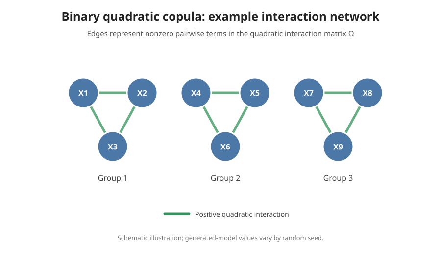

# Binary-Quadratic-Copula

R code for Binary Quadratic Copula models, estimation, inference, and simulation examples.

## Example: visualize a binary quadratic copula model

The graphic below illustrates the quadratic interaction structure (`Omega`) for a simulated 9-variable model. Nodes are binary variables; edges represent nonzero pairwise quadratic interactions. Green edges indicate positive interactions. This is a schematic example, not a fit to observed data.



You can create a network plot from a reproducible simulated model with the package's `plot_network()` function. This example plots the simulated model's true interaction matrix; to visualize estimated interactions instead, pass the result from `estimate()`.

```r
# Install igraph if needed: install.packages("igraph")
set.seed(42)
sim <- quadcopula::generate_dgp(n = 500, d = 9, dgp_type = 1)

png("binary-quadratic-copula-network.png", width = 900, height = 700)
quadcopula::plot_network(
  list(Omega = sim$Omega_true),
  threshold = 0.05,
  main = "Simulated binary quadratic copula interactions"
)
dev.off()
```

Run the complete script in [`examples/plot_binary_quadratic_copula.R`](examples/plot_binary_quadratic_copula.R). It saves the generated graphic as `binary-quadratic-copula-network.png` in the current working directory. `plot_network()` requires the optional `igraph` package.
