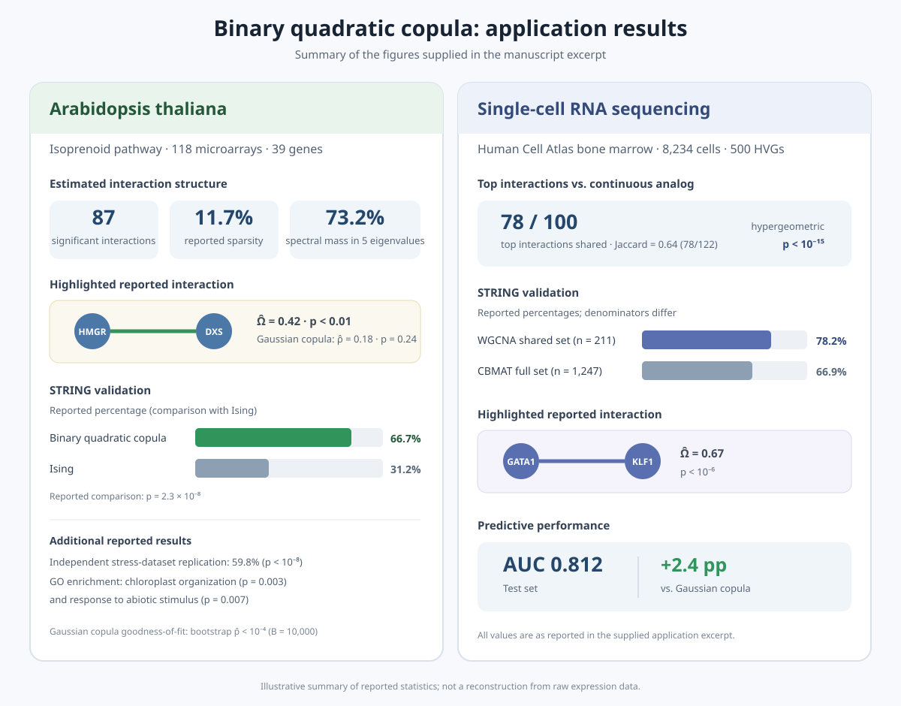

# Application-results figure

This figure visualizes only the numerical results supplied in the application excerpt. It is not a reanalysis: raw expression data, gene lists, fitted model objects, and validation sets were not included with the repository. Treat the values and biological interpretations as reported results that require their source data and analysis to reproduce. The interaction cartoons highlight the named pairs only and do not depict a complete estimated network.

The figure includes the reported Arabidopsis isoprenoid-pathway results (118 microarrays, 39 genes) and Human Cell Atlas bone-marrow single-cell results (8,234 cells, 500 highly variable genes), including the reported STRING-validation rates and highlighted HMGR–DXS and GATA1–KLF1 interaction estimates.
